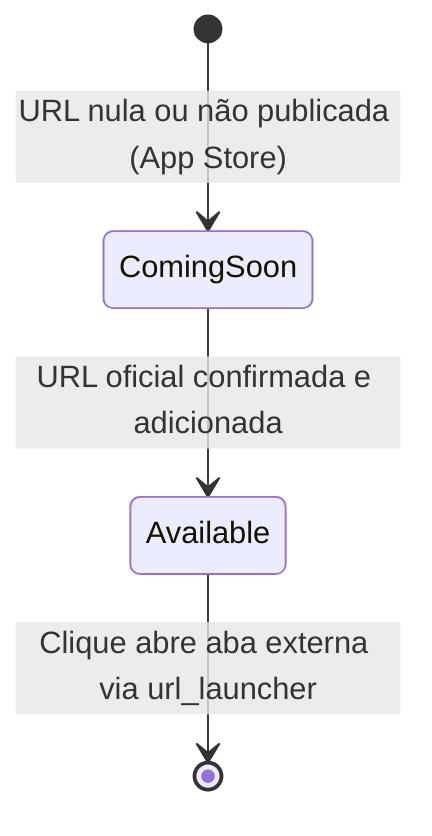
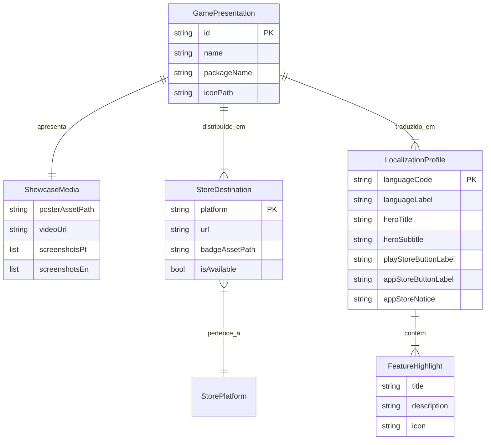

# Data Model: Página de Divulgação do Sports Merge

**Feature**: Sports Merge Landing Page  
**Card**: FAL-67  
**Branch**: `feat/FAL-67-sports-merge-landing-page`  
**Status**: Completed  

Este documento descreve as entidades, estruturas de dados e contratos de conteúdo utilizados para renderizar a página responsiva e bilíngue de divulgação do jogo **Sports Merge**.

---

## 1. Entidades Principais

### 1.1 `GamePresentation`
Representa os metadados agregados do jogo exibidos na página de destino.

| Campo | Tipo | Descrição | Regras de Validação |
|---|---|---|---|
| `id` | `String` | Identificador único do jogo (`sports-merge`) | Não nulo, slug minúsculo |
| `name` | `String` | Nome oficial do jogo (`Sports Merge`) | Não vazio |
| `packageName` | `String` | ID do pacote no Android/iOS (`com.fallkey.sports_merge`) | Formato reverse domain |
| `iconPath` | `String` | Caminho do asset do ícone/logo oficial | Deve existir em `assets/` |
| `destinations` | `List<StoreDestination>` | Lista de lojas onde o app pode ser baixado | Mínimo 1 destino |
| `media` | `ShowcaseMedia` | Mídias de vídeo, poster e capturas de tela | Pelo menos 1 poster válido |

---

### 1.2 `LocalizationProfile`
Modela todo o catálogo de textos e chamadas nos idiomas suportados (`pt-BR` e `en-US`).

| Campo | Tipo | Descrição | Exemplo (pt / en) |
|---|---|---|---|
| `languageCode` | `String` | Código do idioma (`pt` ou `en`) | `pt` / `en` |
| `languageLabel` | `String` | Rótulo do botão seletor | `PT` / `EN` |
| `heroTitle` | `String` | Título de impacto principal | "Junte as bolas e marque pontos!" / "Merge balls and score high!" |
| `heroSubtitle` | `String` | Subtítulo explicativo | "O viciante jogo de física e estratégia esportiva" / "The addictive physics and sports strategy game" |
| `playStoreButtonLabel` | `String` | Rótulo do botão da Google Play | "Disponível na Google Play" / "Get it on Google Play" |
| `appStoreButtonLabel` | `String` | Rótulo do botão da Apple Store | "Em breve na App Store" / "Coming soon to App Store" |
| `appStoreNotice` | `String` | Mensagem do estado de lançamento | "O jogo está em fase final de publicação na App Store." / "The game is coming soon to the App Store." |
| `featuresTitle` | `String` | Título da seção de recursos | "Por que jogar Sports Merge?" / "Why play Sports Merge?" |
| `features` | `List<FeatureHighlight>` | Lista de destaques com ícone e texto | 3 a 5 itens por idioma |
| `privacyPolicyLabel` | `String` | Rótulo do link de privacidade | "Política de Privacidade" / "Privacy Policy" |
| `supportLabel` | `String` | Rótulo do link de suporte | "Central de Suporte" / "Support Center" |
| `copyrightText` | `String` | Texto de direitos autorais | "© 2026 FallKey. Todos os direitos reservados." / "© 2026 FallKey. All rights reserved." |

---

### 1.3 `FeatureHighlight`
Representa um diferencial ou mecânica de jogo destacada na seção de características.

| Campo | Tipo | Descrição |
|---|---|---|
| `title` | `String` | Título do recurso (ex: "Física Realista", "Ranking Global") |
| `description` | `String` | Descrição resumida da mecânica |
| `icon` | `IconData` | Ícone Material / Cupertino representativo |

---

### 1.4 `StoreDestination`
Modela uma plataforma de distribuição e o respectivo botão de download.

| Campo | Tipo | Descrição | Estado / Regras |
|---|---|---|---|
| `platform` | `StorePlatform` | Enum: `googlePlay` ou `appStore` | Obrigatório |
| `url` | `String?` | URL oficial da loja | Se nulo, aciona estado `comingSoon` |
| `badgeAssetPath` | `String` | Caminho do badge gráfico da loja | Deve existir em `assets/` |
| `isAvailable` | `bool` | `true` se pronto para download imediato | Se `false`, exibe badge informativo "Em breve" |

#### State Transition: `StoreDestination.isAvailable`

---

### 1.5 `ShowcaseMedia`
Agrupa os recursos multimídia utilizados na seção de demonstração.

| Campo | Tipo | Descrição |
|---|---|---|
| `posterAssetPath` | `String` | Imagem estática de fallback de alta resolução (`poster.jpeg`) |
| `videoUrl` | `String?` | URL ou asset de vídeo de gameplay |
| `screenshotsPt` | `List<String>` | Lista de caminhos das capturas de tela em Português |
| `screenshotsEn` | `List<String>` | Lista de caminhos das capturas de tela em Inglês |

---

## 2. Diagrama de Relacionamento de Entidades

