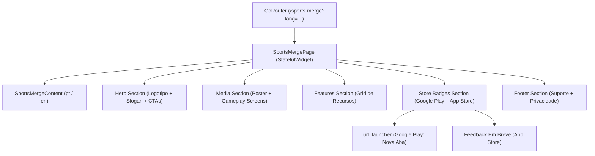

# Implementation Plan: Página de Divulgação do Sports Merge

**Branch**: `feat/FAL-67-sports-merge-landing-page` | **Date**: 2026-11-03 | **Spec**: [specs/001-sports-merge-landing-page/spec.md](specs/001-sports-merge-landing-page/spec.md)

**Input**: Feature specification from `specs/001-sports-merge-landing-page/spec.md` e Linear Card FAL-67.

---

## Summary

Implementar a página web de divulgação do jogo **Sports Merge** no portal FallKey (`fallkey_page`), construída em Flutter Web com arquitetura modular de seções (Hero, Mídias de Gameplay, Recursos/Diferenciais, Badges de Lojas e Rodapé), suporte bilíngue reativo instantâneo (pt-BR e en-US com parâmetro `?lang=...`), layout 100% responsivo para resoluções móveis (360px+) e desktop ultrawide, redirecionamento direto para a Google Play Store e estado informativo para a Apple App Store.

---

## Technical Context

**Language/Version**: Dart 3.11+ / Flutter 3.x  
**Primary Dependencies**: `flutter`, `flutter_web_plugins`, `go_router: ^17.1.0`, `google_fonts: ^8.0.2`, `url_launcher: ^6.3.0`  
**Storage**: N/A (aplicação estática / SPA cliente de apresentação sem persistência de banco de dados)  
**Testing**: `flutter_test`, `mocktail` / `test`  
**Target Platform**: Web (Chrome, Safari, Edge, Firefox mobile e desktop)  
**Project Type**: Flutter Web Application / Landing Page  
**Performance Goals**: Carregamento da imagem poster em < 1.5s, alternância de idioma em < 100ms, ausência de jank em animações (60 fps)  
**Constraints**: Sem rolagem horizontal entre 360px e 2560px, conformidade WCAG 2.1 AA para contraste e touch targets mínimos de 48px  
**Scale/Scope**: 1 página principal modular com 5 seções, 2 componentes reutilizáveis, 1 catálogo de dados desacoplado e testes automatizados  

---

## Constitution Check

*GATE: Must pass before Phase 0 research. Re-check after Phase 1 design.*

- **Princípio I (Multi-Harness Parity & Bundled Distribution)**: Conforme. Execução via scripts padronizados e sem dependência de harness específico.
- **Princípio II (Living Specs & Continuous Autonomous Pipeline)**: Conforme. Branch `feat/FAL-67-sports-merge-landing-page` associada ao Draft PR #1, transição atômica para `Planned` via Linear API.
- **Princípio III (Zero Shell-Escaping Corruption)**: Conforme. Atualização do Linear realizada exclusivamente com payloads UTF-8 via arquivos temporários (`--description-file` e `--comment-file`).
- **Princípio IV (Deterministic Verification & Test Coverage)**: Conforme. Estratégia de testes unitários e de widgets inclusa no plano.
- **Princípio V (Semantic Versioning & Keep a Changelog)**: Conforme. Entradas sob `## [Unreleased]` em `CHANGELOG.md` mapeadas para Conventional Commits (`feat(sports-merge): ...`).

---

## Project Structure

### Documentation (this feature)

```text
specs/001-sports-merge-landing-page/
├── spec.md              # Feature specification
├── plan.md              # This plan file (/speckit-plan output)
├── research.md          # Phase 0 research and decisions
├── data-model.md        # Phase 1 data entities and diagrams
├── contracts/           # Phase 1 contracts
│   └── sports-merge-ui-contract.md
├── quickstart.md        # Phase 1 validation and execution guide
└── tasks.md             # Phase 2 task breakdown (by /speckit-tasks)
```

### Source Code Layout

```text
lib/
├── main.dart                                    # Registro de rotas (/sports-merge) e tema
└── pages/
    ├── privacy_policy_page.dart
    ├── sports_merge_support_page.dart
    ├── under_construction_page.dart
    └── sports_merge/                            # Nova página da landing page
        ├── sports_merge_page.dart               # Top-level Page widget
        ├── models/
        │   └── sports_merge_content.dart        # Modelos e catálogo bilíngue de dados
        └── widgets/
            ├── components/                      # Page components
            │   ├── language_selector.dart       # Seletor PT/EN
            │   └── store_badge_button.dart      # Botão estético com badge das lojas
            └── sections/                        # Page sections (1:1 com a página)
                ├── sports_merge_hero_section.dart
                ├── sports_merge_media_section.dart
                ├── sports_merge_features_section.dart
                ├── sports_merge_store_badges_section.dart
                └── sports_merge_footer_section.dart

assets/
└── sports_merge/                                # Assets sincronizados do jogo
    ├── icon.png
    ├── poster.jpeg
    ├── badges/
    │   ├── google_play_badge.png
    │   └── apple_store_badge.png
    └── screenshots/
        ├── pt/
        └── en/

test/
└── pages/
    └── sports_merge/
        ├── sports_merge_content_test.dart       # Testes unitários do catálogo bilíngue
        └── sports_merge_page_test.dart          # Testes de widget e responsividade
```

**Structure Decision**: Adoção estrita da arquitetura modular do skill `flutter-widgets`, separando a tela principal (`SportsMergePage`) em seções dedicadas (`widgets/sections/`), componentes reutilizáveis (`widgets/components/`) e camada de conteúdo desacoplada (`models/sports_merge_content.dart`).

---

## Complexity Tracking

| Violation | Why Needed | Simpler Alternative Rejected Because |
|---|---|---|
| Nenhuma | N/A | Arquitetura direta e enxuta sem overhead desnecessário |

---

## 1. Diagnóstico e Contexto

O estúdio FallKey possui em seu repositório de jogos o título **Sports Merge** (`fk_games/sports_merge`), um jogo casual de física focado em fusão de bolas esportivas já publicado na Google Play Store (`com.fallkey.sports_merge`).

Atualmente, o site institucional (`fallkey_page`) conta apenas com a página em construção (`/`), a página de política de privacidade (`/sports-merge/privacy`) e a página de suporte (`/sports-merge/support`). Não existe ainda uma vitrine pública de marketing para atrair jogadores, apresentar a jogabilidade com vídeos/capturas e direcioná-los para instalação nas lojas móveis.

A solução consiste em criar a rota `/sports-merge` como landing page de alta conversão, bilíngue (Português/Inglês) com alternância fluida, responsiva para celulares (360px+) e computadores, e pronta para links da Google Play e Apple App Store.

---

## 2. Arquitetura da Solução & Desenho Técnico

A arquitetura adota o padrão de composição de widgets recomendado pelas diretrizes do FallKey:

1. **Camada de Navegação & Roteamento (`main.dart`)**:
   - Rota `/sports-merge` declarada com `GoRoute` e nome `'sports-merge'`.
   - Leitura reativa do parâmetro `state.uri.queryParameters['lang']` para inicialização contextual (`pt` ou `en`).

2. **Camada de Estado e Apresentação (`SportsMergePage`)**:
   - `StatefulWidget` com gerenciamento de idioma em memória para troca instantânea (< 100ms) sem recarregamento.
   - Responsividade com `LayoutBuilder` e pontos de quebra (Mobile < 600px, Tablet 600-1024px, Desktop >= 1024px).
   - Container central com `maxWidth: 1200px` para proteção contra distorção em monitores ultrawide.

3. **Camada de Seções Modulares (`widgets/sections/`)**:
   - `SportsMergeHeroSection`: Título de impacto, subtítulo, logotipo e botões primários de ação (CTA).
   - `SportsMergeMediaSection`: Apresentação visual da jogabilidade com poster estático imediato (< 1.5s) e galeria de telas do jogo (`store-images` em pt e en).
   - `SportsMergeFeaturesSection`: Destaques de jogabilidade (Física Realista, Combos, Ranking, Visual Esportivo) dispostos em grid responsivo.
   - `SportsMergeStoreBadgesSection`: Badges estilizados com clique seguro via `url_launcher` para Google Play e estado amigável "Em breve" para Apple Store.
   - `SportsMergeFooterSection`: Links diretos para `/sports-merge/support` e `/sports-merge/privacy`, além de copyright e redes da FallKey.

4. **Camada de Conteúdo Bilíngue (`models/sports_merge_content.dart`)**:
   - Classes `SportsMergeContent` e `LocalizationProfile` centralizando todos os textos, facilitando testes automatizados e evolução para l10n formal.



---

## 3. Checklist de Arquivos Impactados

- [ ] `pubspec.yaml`
- [ ] `lib/main.dart`
- [ ] `lib/pages/sports_merge/sports_merge_page.dart`
- [ ] `lib/pages/sports_merge/models/sports_merge_content.dart`
- [ ] `lib/pages/sports_merge/widgets/components/language_selector.dart`
- [ ] `lib/pages/sports_merge/widgets/components/store_badge_button.dart`
- [ ] `lib/pages/sports_merge/widgets/sections/sports_merge_hero_section.dart`
- [ ] `lib/pages/sports_merge/widgets/sections/sports_merge_media_section.dart`
- [ ] `lib/pages/sports_merge/widgets/sections/sports_merge_features_section.dart`
- [ ] `lib/pages/sports_merge/widgets/sections/sports_merge_store_badges_section.dart`
- [ ] `lib/pages/sports_merge/widgets/sections/sports_merge_footer_section.dart`
- [ ] `assets/sports_merge/icon.png`
- [ ] `assets/sports_merge/poster.jpeg`
- [ ] `assets/sports_merge/badges/google_play_badge.png`
- [ ] `assets/sports_merge/badges/apple_store_badge.png`
- [ ] `test/pages/sports_merge/sports_merge_content_test.dart`
- [ ] `test/pages/sports_merge/sports_merge_page_test.dart`

---

## 4. Estratégia de Testes

1. **Testes Unitários (`test/pages/sports_merge/sports_merge_content_test.dart`)**:
   - Validar integridade e paridade do catálogo nos idiomas `pt` e `en` (nenhuma chave vazia).
   - Validar formatação da URL da Google Play Store (`https://play.google.com/store/apps/details?id=com.fallkey.sports_merge`).
   - Validar resolução do parâmetro `lang` (strings `pt`, `pt-BR`, `en`, `en-US`, nulo ou desconhecido).

2. **Testes de Widget (`test/pages/sports_merge/sports_merge_page_test.dart`)**:
   - Renderização inicial da página e verificação da presença de Hero, títulos e botões das lojas.
   - Testar interação com o seletor de idioma e verificar atualização imediata dos textos na árvore de widgets.
   - Testar clique no botão da Google Play e verificar invocação de abertura de link externo.
   - Testar clique no botão da Apple Store e validar exibição do aviso amigável "Em breve".
   - Testar renderização responsiva simulando viewports mobile (360x640) e desktop (1920x1080) garantindo ausência de `RenderFlex overflowed`.

3. **Comando de Execução**:
   ```bash
   flutter test test/pages/sports_merge/
   ```

---

## 5. Plano Gitflow

- **Repositório**: `fallkey_page`
- **Branch Alvo**: `feat/FAL-67-sports-merge-landing-page`
- **Branch Base**: `main`
- **Draft Pull Request**: [#1 — feat(sports-merge): criar página de divulgação do jogo Sports Merge (FAL-67)](https://github.com/CaioCoelhoChaves/fallkey_page/pull/1)
- **Convenção de Commits**:
  - `docs(plan): technical plan and architecture for FAL-67`
  - `feat(sports-merge): ... (FAL-67)`
- **Fluxo de Conclusão**:
  - Os commits de especificação e planejamento são enviados para a branch do Draft PR.
  - A transição no Linear é avançada de forma 100% autônoma de `Backlog` para `Planned`.
  - A revisão do desenvolvedor ocorre diretamente no GitHub Draft PR.
